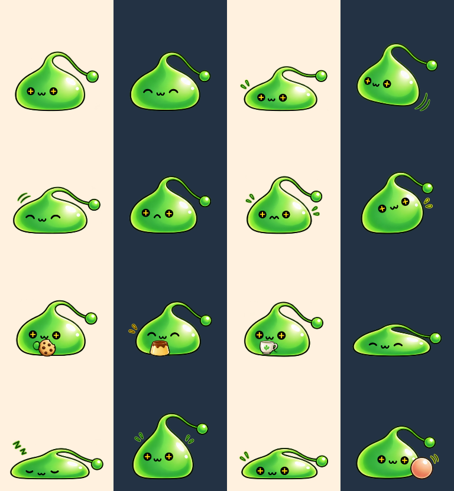
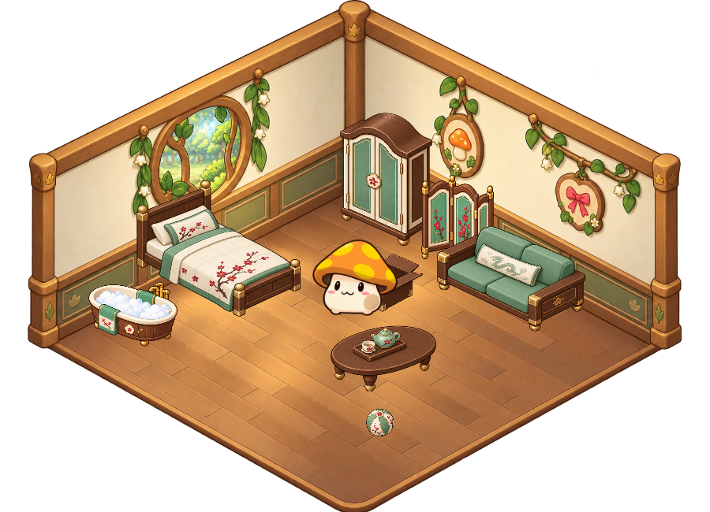
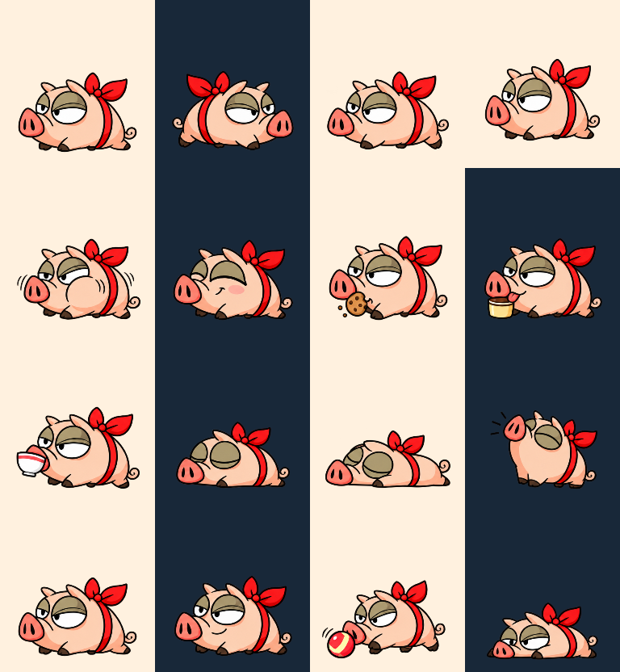
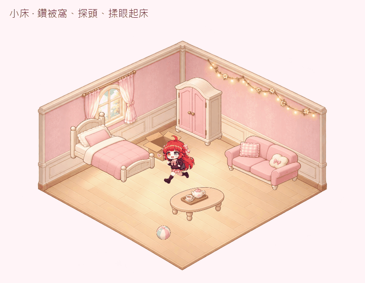
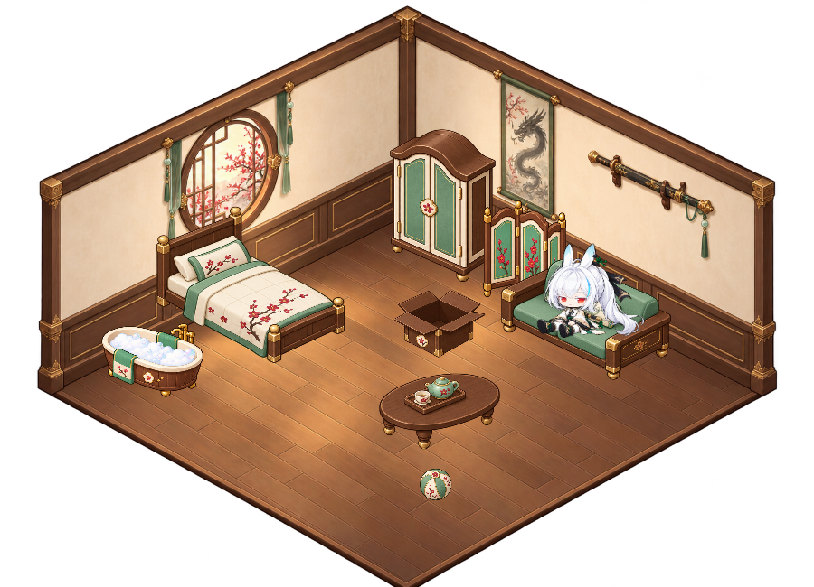
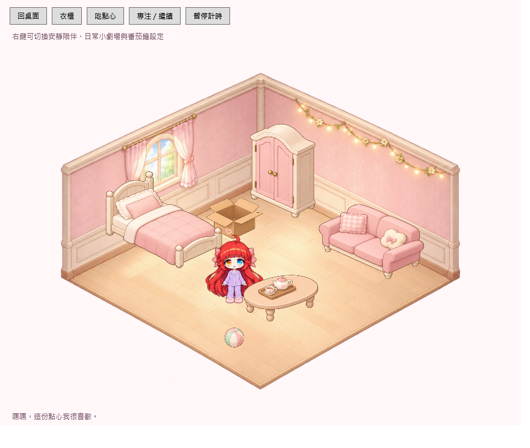
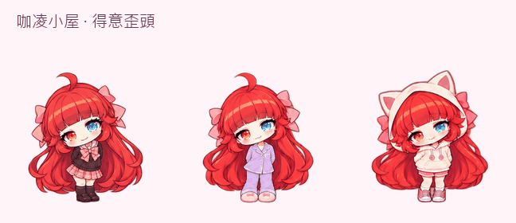
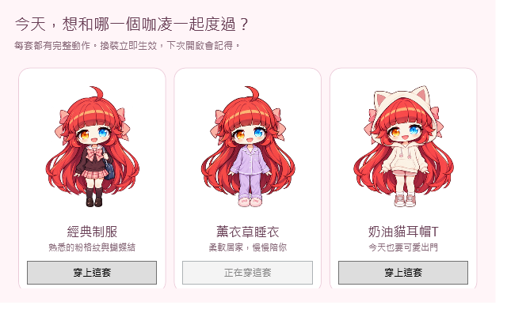

# 楓之谷桌面夥伴 · Windows 桌面寵物

**v1.7.0 綠水靈加入**：黑色圓眼內的金色十字、圓潤果凍身體與小球觸角；有彈跳、摸摸、三種點心、小屋及電子雞生活。右鍵 → **角色 → 綠水靈**。[造型與驗收](docs/SLIME.md)。



**v1.6.1 怪物原作比例更新**：依確認稿重畫菇菇寶貝與緞帶肥肥，各有 16 個完整姿態，桌面、小屋、點心及照顧反應同步更新。[互動動畫圖鑑](preview.html) · [素材與驗收](docs/MONSTERS-ASSETS.md)。

**v1.6.0 蓮的日常**：依確認後的楓之谷比例重做蓮，加入連續呼吸、眨眼、留意滑鼠與摸頭反應；約每 20–50 秒自然做個小動作。走路、點心、坐睡、劍術、小屋與照顧反應都使用同一套新造型。[60 秒新舊對照](life-preview.html) · [更新與驗收](docs/REN-LIFE.md)。

咖凌、蓮、菇菇寶貝、緞帶肥肥與綠水靈都在同一個角色選單，可吃喝、睡覺、如廁、亂大便、洗澡與進小屋；新安裝仍預設蓮。

下載整合包後完整解壓縮，先關閉舊版，再雙擊 `Start.vbs` 或 `Start.bat`。右鍵 → **角色** → 選綠水靈、菇菇寶貝、緞帶肥肥、咖凌或蓮。蓮的攻擊由 **劍術 · 蓮** 施放；也可從系統匣操作。

- 咖凌的三套服裝保留；蓮穿白金衣裝，保留 104 格角色動畫與 12 格透明特效。
- 單擊仍是摸頭／揮手；攻擊只能從選單觸發。專注計時、安靜陪伴、隱藏時停用劍術。
- 拖曳、換角、換裝、縮放與隱藏會中斷出招；劍光不接收滑鼠，也不奪取工作焦點。
- 設定升級至版本 3，自動沿用舊服裝、位置和偏好；各角色會記住自己的服裝。個人設定不隨下載包發布。
- 開啟 [互動動畫圖鑑](preview.html) 可離線切換角色與試播三招；[素材來源與提示詞](docs/REN-ASSETS.md)、[驗收紀錄](docs/REN-VALIDATION.md)。


生活小屋已整合：換角會取消原活動，五位角色共用房間與玩具位置。咖凌保留五組專用小屋動作；蓮暫以摸頭、坐姿、睡眠、揮手與探頭呈現小屋互動，尚無專用抱枕／被窩素材。小屋的劍術選單會顯示「回桌面施放」，選招後收合小屋並施放。進屋仍會清除特效。Windows 版與 Codex 原生 Pets 套件分開。

下載 [v1.7.0 Windows 整合包](https://github.com/Li-Syuan/kaling-desktop-pet/releases/download/v1.7.0/KalingPet-Windows.zip)。本包包含五位角色、完整生活系統、角色主題小屋、蓮的新版日常與三位怪物的日常動作；既有設定會保留。

---


## 綠水靈、菇菇寶貝與緞帶肥肥

右鍵角色或系統匣 → **角色**，即可切換。畫面同時只出現一位，位置、尺寸、移動偏好與番茄鐘繼續保留。已有 v1.4 存檔不會改掉你選的角色；新夥伴從自己的健康初始狀態開始。

| 角色 | 日常個性 | 造型與小屋 |
| --- | --- | --- |
| 綠水靈 | 軟Q彈跳、攤平休息、拉長縮回，發出「啵啵」 | 黑色圓眼與金色十字、森林小窩的淺綠色介面 |
| 菇菇寶貝 | 蹦跳、歪菇帽、縮成一團，說話帶著「菇！」 | 橘色大菇帽、森林小窩的綠色介面 |
| 緞帶肥肥 | 小短腿踏步、趴地打盹、得意扭扭，發出「哼哼」 | 經典紅緞帶、森林小窩的蜜桃色介面 |

三位各有 16 張姿態原圖，配合左右翻轉、位移、伸縮與擺動，組成 26 組日常／小屋動作、112 個播放影格。視線方向、摸摸、三種點心、睡眠、伸展、提起、探頭、推球和紙箱互動都有接入。牠們不會使用蓮的劍術。

森林小窩新增葉窗、菇菇與紅緞帶牆飾；沿用現有木製家具和生活設施。三位目前各提供一種經典造型，沒有額外換裝。各角色的飽足、心情、消化、如廁熟練度和便便獨立保存，未選用時暫停。





[素材、提示詞與動作設計](docs/MONSTERS-ASSETS.md) · [v1.5.0 驗收](docs/MONSTERS-VALIDATION.md) · [離線互動圖鑑](preview.html)

## 電子雞生活：從照顧開始

- **預設蓮**：新安裝、第一次從舊版升級會選蓮；咖凌的服裝、桌面位置與番茄鐘仍保留，以後記住你的角色選擇。
- **餵食**：右鍵 → 點心。餅乾／布丁吃完才增加飽足並開始消化，飽了會婉拒；茶改善心情。拖走或換角中斷用餐不會算吃完。
- **想上廁所**：吃完約 8–12 分鐘出現便意，30 秒預告時可點文字泡泡，或從右鍵／系統匣 → 帶回小屋上廁所。熟練後會自己去，但偶爾仍會失誤。
- **亂大便**：桌面與小屋空地都可能留下卡通便便。點一下就會變成泡泡消失，或使用「全部清理」。每位角色最多三坨，每次至少間隔 10 分鐘。
- **如廁訓練**：成功引導一次，自主如廁機率增加 10%，從 20% 最高提升到 90%；失誤不扣進度。桌面出發會暫時開小屋，完成後回原位置。
- **洗澡與睡覺**：點小屋浴盆或右鍵 → 電子雞生活 → 回小屋洗澡；清潔完成才恢復數值。睡眠每分鐘恢復約 30 點精神。
- **查看狀態**：滑鼠移到角色上，或右鍵 → 電子雞生活，查看飽足、精神、清潔、心情與訓練進度。需要照顧時會用動作與短句提醒。
- **不打擾工作**：番茄鐘、安靜陪伴、手動隱藏、全螢幕隱藏期間暫停生活消耗。關閉、休眠、未選用的角色也不計算離線消耗；不會死亡、生病或堆積離線便便。
- **隨時暫停**：右鍵或系統匣取消「啟用電子雞生活」，可回到原本的桌面陪伴模式；資料保留。

升級請把新 ZIP 解壓到完整的新資料夾，再開 `Start.bat`。設定仍在 `%LOCALAPPDATA%\KalingPet\settings.json`，自動升級並保留 `.bak`。不要只覆蓋 `pet.ps1`，本版新增 `assets/care/` 與兩個生活模組。

[電子雞驗收與限制](docs/CARE-VALIDATION.md) · [離線互動預覽](preview.html)


## 咖凌 · Kaling Desktop Pet

紅髮異色瞳的 Windows 桌面夥伴。**v1.3 加入可收合的斜角生活小屋**：陪她吃點心、鑽被窩、抱枕放空，拖動玩具逗她玩。三套服裝都支援完整小屋互動。



## 使用 GitHub Code ZIP

**Code → Download ZIP 已包含完整的五位角色、蓮的技能特效與所有小屋素材**，不需要另抓素材。下載 [main 原始碼 ZIP](https://github.com/Li-Syuan/kaling-desktop-pet/archive/refs/heads/main.zip) 後，先從系統匣關閉舊程式，再「全部解壓縮」，進入 `kaling-desktop-pet-main`，雙擊 `Start.bat` 或 `Start.vbs`。

施放技能：右鍵角色或系統匣 → **角色 → 蓮** → **劍術 · 蓮** → 選擇招式。小屋內選擇「回桌面施放 · 招式」會自動收合並出招。技能選單第一列會說明目前狀態：計時中須先暫停，安靜陪伴須先關閉，隱藏／拖曳中須先恢復操作。

`preview.html` 是動畫圖鑑，不能控制正在執行的桌面角色。請勿直接在壓縮檔內啟動，也不要只複製 `pet.ps1`；整個資料夾必須一起保留。舊程式若仍在執行，單一實例限制會讓新啟動程序退出。

## 下載與開始

1. 從 [最新版本](https://github.com/Li-Syuan/kaling-desktop-pet/releases/latest) 下載 `KalingPet-Windows.zip`。
2. 從系統匣關閉舊版，將新版「全部解壓縮」。
3. 雙擊 `Start.vbs`；系統不支援 VBScript 時改用 `Start.bat`。
4. 右鍵角色 → **打開生活小屋…**，或從系統匣選「打開／回到生活小屋」。

Windows 10 / 11，使用內建 Windows PowerShell 5.1 與 WPF，免安裝、免 Python／Node.js，離線即可使用。啟動器只對當次程序指定 ExecutionPolicy Bypass，不修改永久原則。程式不連網、不讀取個人文件、不加入開機啟動。

## 蓮專屬 · 梅影劍居

切換角色時，小屋會一起換成角色自己的風格。蓮住在深木、白金與青綠配色的居所，窗外梅花、牆上掛劍與龍紋卷軸；咖凌保留粉色奶油小屋。



梅紋小榻、青竹長椅、白金衣櫃、青瓷茶席、梅紋鞠球與行囊木箱都有獨立外觀，房間配色、名稱、提示與台詞也會切換。床被及木箱遮擋同步換新；房內換角維持同一個視窗，保留房間位置與玩具位置。五位角色目前共用家具配置與玩具擺放。

這次更新房間及家具素材，蓮仍沿用既有日常姿勢，沒有另製抱枕動作。[製作與驗收紀錄](docs/REN-HOME.md)。

## 可收合的生活小屋



粉色、奶油色與木地板搭配的斜角娃娃屋。咖凌進屋後，桌面角色會收起；點「回桌面」或關閉小屋視窗，回到原本位置與移動模式。同時只有一隻咖凌。每次重新啟動預設小屋收合。

| 點選／拖動 | 咖凌的回應 |
| --- | --- |
| 小床 | 走近、坐下、鑽被窩；睡著後點床或咖凌，探頭再揉眼起床 |
| 沙發 | 走過去抱枕放空，偶爾抱膝打瞌睡 |
| 茶几／吃點心 | 選餅乾、布丁或茶；走過去吃喝，偶爾得意歪頭 |
| 衣櫃 | 開啟原有三套服裝介面；換裝後留在小屋 |
| 玩具球 | 點擊會走近輕碰；拖動放開後短距離滾動，再跟過去玩 |
| 紙箱 | 拖到空地搬家；點一下探頭、躲進去、再冒出來 |
| 咖凌 | 摸摸頭，偶爾露出得意表情 |

家具位置固定；球與紙箱的整個底部都必須留在可走的空地，不能重疊、壓到家具或越界。無效放置會回到原位。拖曳期間暫停活動，放開才回應；新的明確操作會中斷前一個活動。

開啟「日常小劇場」時，約每 30–60 秒自主坐沙發、喝茶或查看紙箱；五分鐘沒有操作便走到床上休息。番茄鐘進行中不追球、不自發玩鬧；安靜陪伴也會停止自主活動。小屋右鍵可更改這些偏好；全螢幕與手動隱藏會一起隱藏小屋，計時照常進行。桌面穿透偏好在回到桌面後套用，小屋保留家具和玩具操作。



離線 `preview.html` 可切換五段實際 WPF 小屋動畫，並逐一播放三套服裝的二十四組動作。小屋預覽是錄製動畫，拖曳互動請在 Windows 程式中操作。

## 衣櫃與新動作

| 服裝 | 特色 |
| --- | --- |
| 經典制服 | 粉格紋、蝴蝶結與熟悉的小書包 |
| 薰衣草睡衣 | 成套長袖睡衣與粉紅拖鞋 |
| 奶油貓耳帽 T | 戴起貓耳帽、粉紅短褲與球鞋 |



- **摸頭、害羞**：閉眼微笑、歪頭與臉紅。
- **吃喝**：餅乾、布丁和茶各有自己的拿取、進食與滿足表情。
- **坐下晃腳**：左右腳交替擺動。
- **抱膝睡覺**：慢慢閉眼，睡著後停留在睡姿，點一下叫醒。
- **揉眼睛、伸懶腰**：醒來或手動選擇時播放。
- **開心轉圈**：完整正面、側面、背面與另一側；換裝和完成番茄鐘也會轉圈。
- **提起晃腳**：拖曳時雙腳懸空，放下後回到站姿。
- **螢幕邊緣探頭**：短暫移到所在螢幕左邊緣，再回原位；保存的常用位置不會被改成邊緣位置。

開啟「日常小劇場」時，閒置兩分鐘會坐下、五分鐘會打瞌睡；計時中、安靜陪伴或衣櫃／時間設定開啟時不自動入睡。右鍵「動作」也可直接指定。既有九組動作與十六個視線方向仍可使用。

## 操作與陪伴功能

| 操作 | 功能 |
| --- | --- |
| 左鍵拖曳 | 提起晃腳並移動位置 |
| 點頭部／身體 | 摸頭／揮手；等待系統雙擊間隔後回應 |
| 點兩下 | 跳躍 |
| 點睡著的咖凌 | 揉眼睛、伸懶腰醒來 |
| 右鍵 | 衣櫃、餵食、番茄鐘、動作、模式、大小與偏好 |
| `Ctrl+Alt+K` | 開啟／關閉滑鼠穿透 |
| `Ctrl+Alt+H` | 顯示／隱藏 |
| 系統匣 | 衣櫃、恢復互動、番茄鐘、叫咖凌回來與退出 |
| `preview.html` | 離線切換三套服裝、二十四組動作與滑鼠視線 |

番茄鐘預設專注 25 分鐘、短休息 5 分鐘，每四輪長休息 15 分鐘，可調整為 1–180 分鐘。下一階段需手動開始；重開或睡眠後暫停並保留進度。心情泡泡與時段小劇場約每 8–15 分鐘出現一次，專注或安靜陪伴時不自發打擾，必要的計時提示仍保留。全螢幕或手動隱藏時泡泡也隱藏，計時繼續。

預設留在原地，也可自由散步或跟隨滑鼠。重複啟動不產生第二隻。快捷鍵被占用時仍能使用系統匣。找不到咖凌時，選「叫咖凌回來」可恢復互動、移回主要螢幕並暫時關閉自動隱藏。

## 設定與升級

v1.1／v1.2 設定可直接沿用，保留既有衣服與偏好；新增小屋視窗與玩具位置保存。首次開啟沒有設定時預設穿制服。服裝、位置、大小、移動方式、視線、泡泡與番茄鐘偏好會自動保存。

個人資料只保存在 `%LOCALAPPDATA%\KalingPet`。`settings.json` 使用安全替換並保留 `.bak`；損壞設定先另存 `.corrupt-*` 再恢復預設值。計時每十秒與正常關閉時保存，意外中斷最多可能少記最後十秒。程式關閉時不繼續計時。

## 素材與驗證

- 三張透明 PNG 圖集：制服 133 格、睡衣 112 格、貓耳裝 112 格，共 **357 格**；每格 192×208。
- `assets/room/`：小屋背景、六件家具／玩具及 [v1.3 生成提示詞](assets/room/prompts.json)。
- `assets/outfits/`：圖集、衣櫃縮圖、動作數量設定與 [生成提示詞](assets/outfits/prompts.json)。
- `animations/<服裝>/`：每套二十四組 GIF；GIF 為粉色底預覽，桌面實際使用透明 PNG。
- 原本的 `spritesheet.png` 與九組 GIF 保留，供既有素材使用者延續使用。
- **整合版原始碼驗收：135 項狀態測試、562 項 WPF／原生整合檢查通過**，另有圖集透明度、邊界、空格、動畫差異與離線圖鑑邏輯檢查。

```powershell
powershell.exe -NoProfile -ExecutionPolicy Bypass -File .\tests\State.Tests.ps1
.\Start.bat --self-test
```

自我測試使用獨立資料夾，會短暫開啟測試視窗；只有能確認命中自己的測試視窗時才發送實體測試輸入。實體操作的驗證依 Windows 當下前景／命中測試而定；無法確認是測試視窗時跳過輸入。跨程式實際點擊穿透、實體拖曳、多螢幕混合 DPI 與電腦睡眠仍有未驗證項目。細節見 [驗證紀錄](docs/VALIDATION.md)。

本專案為獨立 Windows 桌面程式，不讀取 Codex 聊天狀態。v1.3 的生活小屋、衣櫃與擴充圖集屬於 Windows 版；Codex 原生 Pets 使用另外的寵物套件。

## 創作來源

角色依提供的「咖凌」參考圖製作，新增美術使用內建 imagegen 生成，再整理透明邊界、畫格尺寸與動畫。個人同人作品，非官方產品。程式碼採 MIT 授權；角色名稱、設定及圖像不包含在程式碼的 MIT 授權範圍。
