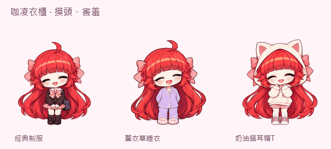

# 咖凌 · Kaling Desktop Pet

紅髮異色瞳的 Windows 桌面夥伴。**v1.2 加入衣櫃、三套服裝與八類新動作**，換裝後走路、吃點心、打瞌睡都會維持同一套衣服。



## 下載與開始

1. 從 [最新版本](https://github.com/Li-Syuan/kaling-desktop-pet/releases/latest) 下載 `KalingPet-Windows.zip`。
2. 從系統匣關閉舊版，將新版「全部解壓縮」。
3. 雙擊 `Start.vbs`；系統不支援 VBScript 時改用 `Start.bat`。
4. 右鍵咖凌 → **咖凌衣櫃…** → 選擇「穿上這套」。

Windows 10 / 11，使用內建 Windows PowerShell 5.1 與 WPF，免安裝、免 Python／Node.js，離線即可使用。啟動器只對當次程序指定 ExecutionPolicy Bypass，不修改永久原則。程式不連網、不讀取個人文件、不加入開機啟動。

## 衣櫃與新動作

| 服裝 | 特色 |
| --- | --- |
| 經典制服 | 粉格紋、蝴蝶結與熟悉的小書包 |
| 薰衣草睡衣 | 成套長袖睡衣與粉紅拖鞋 |
| 奶油貓耳帽 T | 戴起貓耳帽、粉紅短褲與球鞋 |


- **摸頭、害羞**：閉眼微笑、歪頭與臉紅。
- **吃喝**：餅乾、布丁和茶各有自己的拿取、進食與滿足表情。
- **坐下晃腳**：左右腳交替擺動。
- **抱膝睡覺**：慢慢閉眼，睡著後停留在睡姿，點一下叫醒。
- **揉眼睛、伸懶腰**：醒來或手動選擇時播放。
- **開心轉圈**：完整正面、側面、背面與另一側；換裝和完成番茄鐘也會轉圈。
- **提起晃腳**：拖曳時雙腳懸空，放下後回到站姿。
- **螢幕邊緣探頭**：短暫移到所在螢幕左邊緣，再回原位；保存的常用位置不會被改成邊緣位置。

開啟「日常小劇場」時，閒置兩分鐘會坐下、五分鐘會打瞌睡；計時中、安靜陪伴或衣櫃／時間設定開啟時不自動入睡。右鍵「動作」也可直接指定。既有九組動作與十六個視線方向仍可使用。

## 操作與陪伴功能

| 操作 | 功能 |
| --- | --- |
| 左鍵拖曳 | 提起晃腳並移動位置 |
| 點頭部／身體 | 摸頭／揮手；等待系統雙擊間隔後回應 |
| 點兩下 | 跳躍 |
| 點睡著的咖凌 | 揉眼睛、伸懶腰醒來 |
| 右鍵 | 衣櫃、餵食、番茄鐘、動作、模式、大小與偏好 |
| `Ctrl+Alt+K` | 開啟／關閉滑鼠穿透 |
| `Ctrl+Alt+H` | 顯示／隱藏 |
| 系統匣 | 衣櫃、恢復互動、番茄鐘、叫咖凌回來與退出 |
| `preview.html` | 離線切換三套服裝、十九組動作與滑鼠視線 |

番茄鐘預設專注 25 分鐘、短休息 5 分鐘，每四輪長休息 15 分鐘，可調整為 1–180 分鐘。下一階段需手動開始；重開或睡眠後暫停並保留進度。心情泡泡與時段小劇場約每 8–15 分鐘出現一次，專注或安靜陪伴時不自發打擾，必要的計時提示仍保留。全螢幕或手動隱藏時泡泡也隱藏，計時繼續。

預設留在原地，也可自由散步或跟隨滑鼠。重複啟動不產生第二隻。快捷鍵被占用時仍能使用系統匣。找不到咖凌時，選「叫咖凌回來」可恢復互動、移回主要螢幕並暫時關閉自動隱藏。

## 設定與升級

v1.1 設定可直接沿用，第一次使用 v1.2 預設穿制服。服裝、位置、大小、移動方式、視線、泡泡與番茄鐘偏好會自動保存。

個人資料只保存在 `%LOCALAPPDATA%\KalingPet`。`settings.json` 使用安全替換並保留 `.bak`；損壞設定先另存 `.corrupt-*` 再恢復預設值。計時每十秒與正常關閉時保存，意外中斷最多可能少記最後十秒。程式關閉時不繼續計時。

## 素材與驗證

- 三張透明 PNG 圖集：制服 113 格、睡衣 92 格、貓耳裝 92 格，共 **297 格**；每格 192×208。
- `assets/outfits/`：圖集、衣櫃縮圖、動作數量設定與 [生成提示詞](assets/outfits/prompts.json)。
- `animations/<服裝>/`：每套十九組 GIF；GIF 為粉色底預覽，桌面實際使用透明 PNG。
- 原本的 `spritesheet.png` 與九組 GIF 保留，供既有素材使用者延續使用。
- **32 項狀態測試、108 項 WPF／原生整合檢查通過**，另有圖集透明度、邊界、空格、動畫差異與離線圖鑑邏輯檢查。

```powershell
powershell.exe -NoProfile -ExecutionPolicy Bypass -File .\tests\State.Tests.ps1
.\Start.bat --self-test
```

自我測試使用獨立資料夾，會短暫開啟測試視窗；只有能確認命中自己的測試視窗時才發送實體測試輸入。此環境未能端到端驗證真實前景全螢幕切換、實體快捷鍵與跨程式點擊穿透，實體多螢幕混合 DPI 和電腦睡眠也未強制實測。細節見 [驗證紀錄](docs/VALIDATION.md)。

本專案為獨立 Windows 桌面程式，不讀取 Codex 聊天狀態。v1.2 的衣櫃與擴充圖集屬於 Windows 版；Codex 原生 Pets 使用另外的寵物套件。

## 創作來源

角色依提供的「咖凌」參考圖製作，v1.2 美術使用內建 imagegen 生成，再整理透明邊界、畫格尺寸與動畫。個人同人作品，非官方產品。程式碼採 MIT 授權；角色名稱、設定及圖像不包含在程式碼的 MIT 授權範圍。
