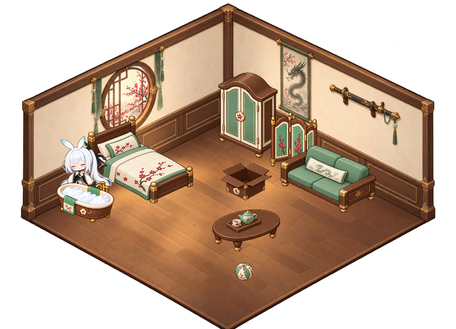
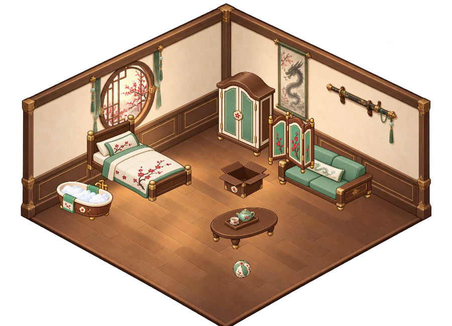

# v1.4.0 電子雞生活驗收

2026-10-16。Windows PowerShell 5.1 / WPF；使用隔離測試資料夾，不覆寫日常存檔。

## 行為

新安裝及版本 1／2 設定首次升級選擇蓮，保留咖凌服裝與既有位置、尺寸、偏好、番茄鐘。版本 3 每位角色各自保存飽足、精神、清潔、心情、消化進度、如廁訓練和地面便便。小屋仍在啟動時收合。

餅乾增加 20 飽足、布丁增加 28，飽足達 88 或三份食物仍在消化時婉拒；茶只改善心情。食物必須吃完才計算。第一份消化 480–720 秒，之後排隊食物每份 600 秒；便意預告 30 秒，每次排便至少間隔 600 秒。滿三坨後暫停新增，仍可引導如廁或清理。

成功引導如廁提高 10% 自主成功率，上限 90%；自主成功和失誤都不改變訓練進度。角色未選用、關閉、休眠、番茄鐘、安靜、手動隱藏、全螢幕隱藏期間不累積生活消耗。超過 5 秒的 Dispatcher 間隙不補算。

## 自動驗證

- `tests/State.Tests.ps1`：135 項，設定／番茄鐘／小屋幾何與行走路線回歸。
- `tests/Care.Model.Tests.ps1`：44 項，受控時間消化、便意、排便間隔與上限、訓練、睡眠、無離線欠帳及版本 1／2 升級。
- `Start.bat --self-test`：562 項，既有 WPF 回歸加電子雞驗收，涵蓋四種角色服裝、真實選單與視窗、餵食完成結算、便便點擊清理、如廁往返、泡澡遮擋、拖曳／換角／換裝／摸頭／隱藏／劍術／專注／關閉中斷，以及便便存檔和螢幕邊界。
- Playwright：離線預覽的四種角色服裝、便意／害羞切換、清理按鈕，未發現頁面 JavaScript 錯誤或缺圖。

最新完整結果見 [WPF 驗收](care-integration.json)、[生活模型](care-model.json)、[狀態回歸](care-state.json)。發布流程另從完整 ZIP 解壓啟動 `Start.bat --self-test`，並確認 GitHub Code ZIP 與提交內容一致。

## 素材與畫面

新素材保留生成 PNG 的原始 alpha，透過 WPF 讀取裁切區域，不改寫圖像像素。[提示詞與參考資料](../assets/care/prompts.json)記錄內建 image_gen 的製作方式。

蓮新增四格便意和四格害羞反應；咖凌三套服裝使用原圖集的等待與摸頭四格，加入生活動作的輕微擺動，避免生成候選素材的邊緣雜點。浴盆沿用角色穿衣動作，透過前景泡泡和裁切遮住下半身；廁所由屏風遮擋。小屋保持單一角色。

## 驗證限制

- Windows 曾拒絕測試視窗取得前景，因此真實全螢幕前景輪詢未能完整端到端驗證；視窗幾何及隱藏狀態切換已驗證。
- 未送出實體跨程式滑鼠點擊；以 WPF 輸入事件、WinForms 選單及原生視窗樣式驗證互動與穿透。
- 未強制電腦休眠，使用長時間間隙驗證；未實測混合 DPI 多螢幕實體拖曳。
- 圖片為實際 WPF 渲染，不是桌面錄影。自主進小屋設定 `ShowActivated=false`，避免主動要求前景焦點。
