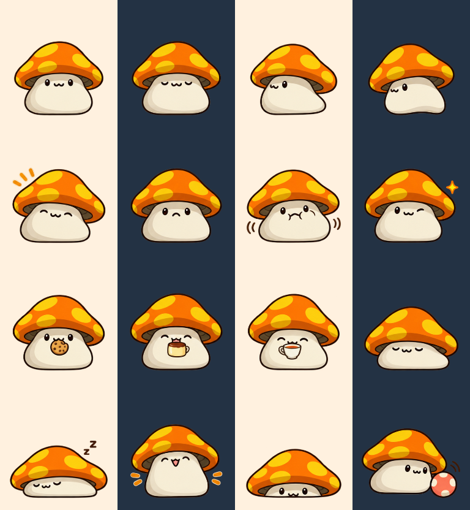
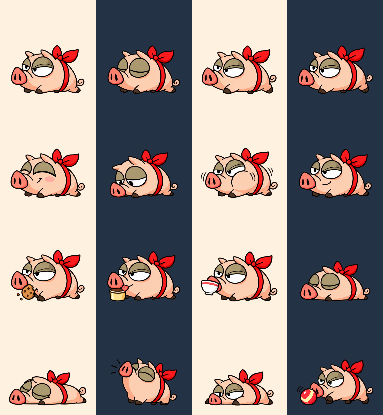
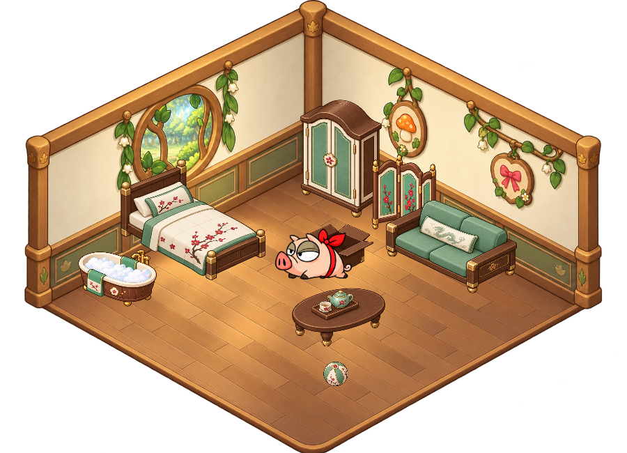

# 菇菇寶貝與緞帶肥肥：v1.6.1 造型與驗收

依使用者確認的兩張完整母圖延伸日常動作。菇菇保留大菇帽、短菇柄與小五官；肥肥保留矮胖身形、半瞇大眼、突出鼻子及紅緞帶。這是楓之谷同人桌面程式，角色權利屬原權利人。

## 造型來源

- 遊戲內造型參考：[Nexon Peak 怪物圖鑑](https://peak.nexon.com/en/post/1534)。[菇菇截圖](https://peak-file.nexon.com/uploads/20260527_0344_25ee8909.png)、[肥肥種類圖](https://peak-file.nexon.com/uploads/20260527_0349_f60c2fed.png)（左起第二隻紅緞帶肥肥）。
- 舊版菇菇以官方社群貼圖、肥肥以 MapleStory LIVE 概念圖為參考；本次改以電腦版遊戲內比例重畫。
- 確認母圖：[菇菇](../assets/characters/mushroom/master.png)、[肥肥](../assets/characters/ribbon-pig/master.png)。使用者回覆「好多了，繼續做」後延伸姿態。
- 圖像使用內建 `image_gen`，不是 API／CLI。完整提示詞：[monster-official-prompts.json](../assets/characters/monster-official-prompts.json)。參考網站原圖不隨專案散布。

## 動畫與透明度

每位 16 張完整繪製姿態，包含待機、眨眼、兩步行走、摸頭、委屈、便意、得意、餅乾、布丁、茶、休息、睡眠、伸展、探頭及玩球。使用位移、鏡射、旋轉及輕微伸縮，組成 26 組動作、112 個播放影格；不是 112 張分別手繪的連續原圖。

生成 PNG 與 alpha 原樣保留。每個姿態以 `catalog.json` 的 `poseRects` 擷取，依固定比例載入共用 192 × 208 播放格。已調整肥肥底列的分隔位置，防止尾巴被切掉或串入鄰格。桌面、小屋、衣櫃縮圖與照顧反應共用同一份素材，離線動畫圖鑑同步更新目錄。

部分肥肥透明像素保留了非零 RGB 底色，但 alpha 為零。圖片預覽若忽略 alpha，可能顯示棕紅底色；實際 WPF 深、淺背景合成均已確認無光暈。沒有對生成 PNG 做顏色篩除或改寫 alpha。

## 驗收

- 實際 WPF 整合測試：998 項通過，涵蓋四角色切換、全部播放影格、小屋家具與玩具、照顧、番茄鐘及蓮的攻擊取消。
- 狀態測試 135 項、照顧模型 44 項、怪物設定 13 項通過。
- 逐張檢視兩位怪物的 16 姿態與實際小屋截圖；保持確認稿比例、短腿、眼神與服飾識別。深淺底均無矩形背景或可見外圈光暈。
- 發布流程另對整合 ZIP 進行 CRC、逐檔內容及解壓後 `Start.bat --self-test` 驗收；GitHub Code ZIP 使用同一流程驗收。最終結果記錄於版本發布頁。
- 環境限制：Windows 拒絕測試視窗取得前景，因此未做實際跨程序點擊、實體滑鼠拖曳與前景全螢幕輪詢驗收；混合 DPI 多螢幕、實體睡眠／喚醒亦未強制測試。家具操作與拖曳邏輯以正式 WPF 控制項和事件處理器測試。

