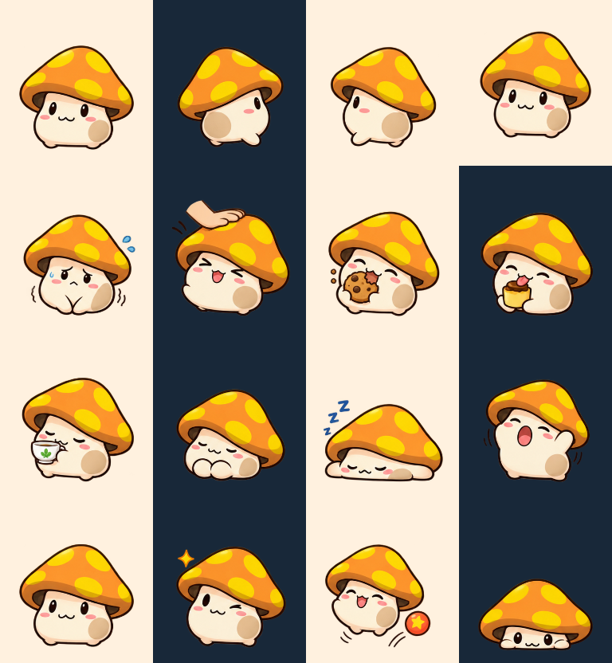

# 森林新夥伴：素材與動畫

2026-10-16。菇菇寶貝（Orange Mushroom）與緞帶肥肥（Ribbon Pig）是新楓之谷角色。本專案是同人桌面程式，角色權利屬原權利人。

## 參考與生成

- 菇菇寶貝：Nexon [官方社群文章](https://www.nexon.com/maplestory/news/community/16028/what-s-your-maple-story-sabishisa)所使用的[菇菇圖片](https://nxcache.nexon.net/cms/2021/q2/1802/mushroom.png)。辨識點：橘色大菇帽、黃色斑點、奶油色菇柄、褐色身體斑點與小表情。
- 緞帶肥肥：[MapleStory LIVE 概念圖頁](https://img.neoseeker.com/v_concept_art.php?caid=25081)及[原圖](https://cdn.staticneo.com/ca/maple_story_conceptart_Yvp2W.jpg)。辨識點：粉紅圓身、四蹄、捲尾、繞身的紅緞帶與背部蝴蝶結，保留半瞇眼。
- 森林小窩以專案既有的蓮房間作構圖參考，替換牆面主題；木製家具、屏風與浴盆沿用現有資產。

三張新圖均使用內建 `image_gen`，不是 API／CLI。PNG 原始像素與 alpha 原封保留在 `assets/characters/mushroom/poses.png`、`assets/characters/ribbon-pig/poses.png` 及 `assets/room/forest/room.png`。參考下載檔不隨專案散布。

共用提示詞與角色識別規格存於 [prompts.json](../assets/characters/monster-prompts.json)。兩位角色各有 4 × 4 姿態板：待機、眨眼、左右行走基礎姿態、被摸、委屈、便意、得意、餅乾、布丁、茶、趴坐、睡眠、伸展、探頭與玩球。原圖不是等尺寸動畫格，因此使用目錄中的 `poseRects` 擷取各姿態，防止鄰格串入。

## 播放方式

每位 16 個繪製姿態，透過關鍵影格的鏡射、伸縮、角度及位移，組成 26 組動作、112 個播放影格；不是 112 張分別繪製的原圖。WPF 首次載入時把關鍵影格渲染到記憶體中的 192 × 208 bitmap 並快取，延續既有小屋、拖曳、視線方向與照顧的播放介面。離線圖鑑套用相同的矩形與變換。

照顧表情引用便意及得意動作。怪物保留原身形，沒有套用人形服裝；目前每位一種經典造型。四位角色共用小屋位置、玩具位置與番茄鐘，生活數值和地面便便各自獨立。

