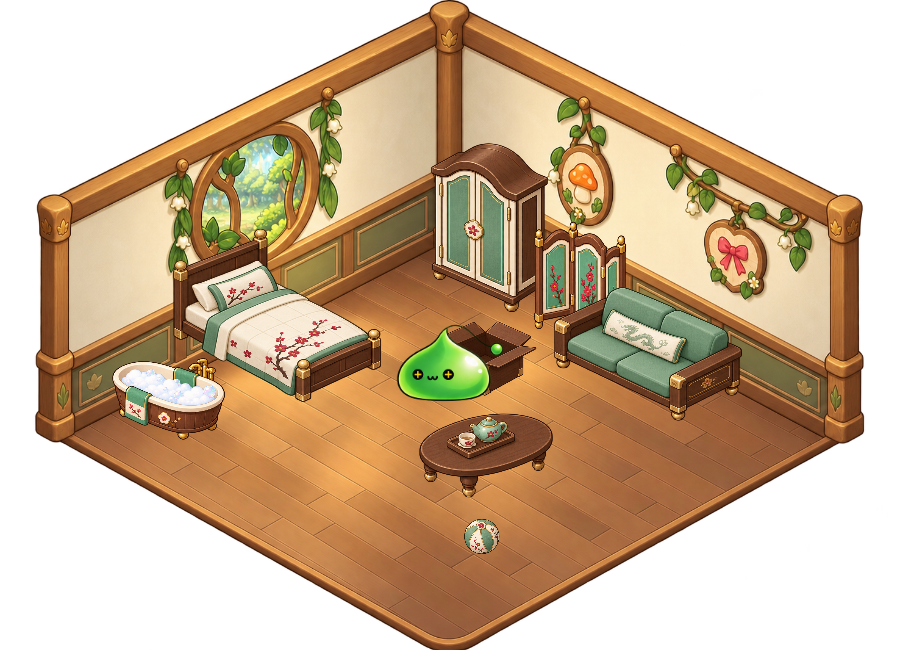
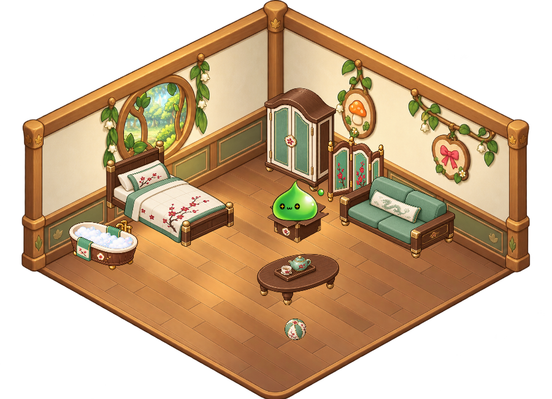
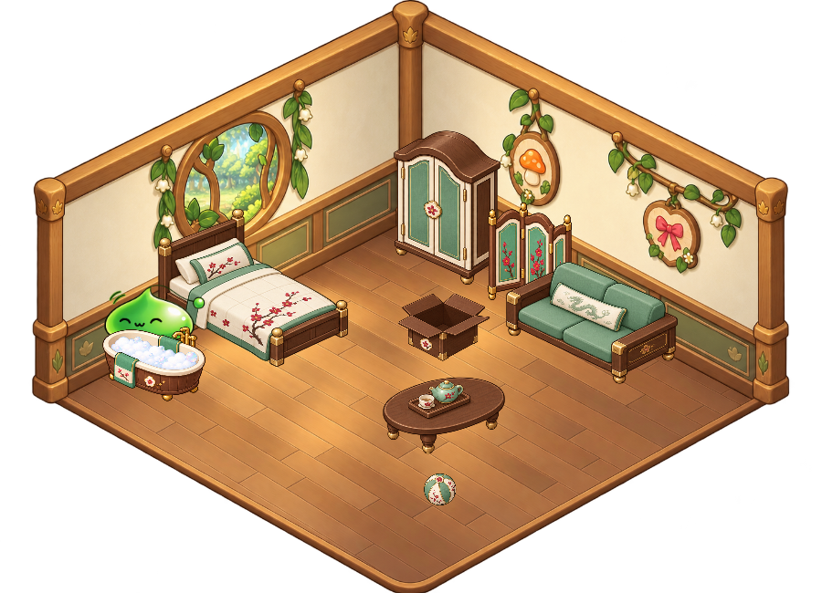

# 綠水靈 · v1.8.0 細線圓球修正

右鍵角色或系統匣 → **角色 → 綠水靈**。新安裝仍預設蓮；既有選角、尺寸、位置、番茄鐘與照顧進度保留。綠水靈從自己的獨立生活狀態開始。

## 造型與動作

依 [Nexon Peak 怪物圖鑑](https://peak.nexon.com/en/post/1534) 的[綠水靈遊戲內動畫](https://peak-file.nexon.com/uploads/20260527_0331_e94d062d.gif)重畫，保留圓潤綠色果凍身體。v1.8.0 再對照 [Nexon 官方 20 週年活動圖](https://maplestory.nexon.com/promotion/20th/2023/20230420/PartyQuest/1st/0066j34qbi3x3s63jvxi4wg)，將頭頂改成**一條細深色線連著一顆綠色圓球**，移除原本粗綠色管狀觸角；母圖與全部 16 個姿態同步修正。眼睛依使用者最新修正採用**黑色圓眼，內含金色十字**；眨眼與睡眠時使用閉眼線條。這是同人重繪，並非官方發布素材。

使用內建 `image_gen` 生成，[母圖](../assets/characters/slime/master.png)、[16 姿態圖集](../assets/characters/slime/poses.png)及[完整提示詞與來源](../assets/characters/slime/prompts.json)均隨專案保存。生成 PNG 與 alpha 原樣保留，未以程式重畫或改色。

16 張姿態配合鏡射、位移、旋轉及輕微伸縮，組成 26 組動作、112 個播放影格，並非 112 張分別繪製的原圖。包括彈跳移動、摸摸、三種點心、攤平、睡眠、伸展、提起、探頭、玩球與箱子互動。睜眼姿態維持黑底金十字。

## 小屋與生活

綠水靈沿用森林小窩、木製家具與生活設施，搭配淺綠介面和專屬「啵啵」短句。床、木箱及浴盆的角色高度依扁圓身形調整；遮擋、躲入及返回桌面仍由共用活動流程處理。其他角色的家具位置與裁切保持原設定。

餵食、消化、如廁、亂大便、洗澡、睡眠與心情均接入原有生活系統。未選用、隱藏、安靜及番茄鐘專注期間沿用暫停規則。綠水靈沒有蓮的劍術，也沒有額外衣裝。

## v1.7.0 加入時的驗收

最新 v1.8.0 的完整回歸與解壓啟動驗證見 [新版本驗收](PLAY-VALIDATION.md)。

- WPF 整合測試 1,194 項通過，涵蓋五角色選單、全部動作、小屋、玩具、餵食與照顧、番茄鐘，以及蓮技能取消；[完整結果](slime-integration.json)。
- 狀態測試 135 項、照顧模型 44 項、怪物存檔 19 項通過。包括由四角色存檔升級，保留既有進度並新增綠水靈。
- 三位怪物的圖集邊界及動作引用 51 項檢查通過；各姿態完整落在裁切範圍內，離線目錄與桌面版一致。
- Playwright 實際瀏覽器驗證三位怪物各 26 組動作按鈕、三種背景、三段小屋預覽與生活清理互動，沒有頁面 JavaScript 錯誤。
- 人工檢視 WPF 深淺底、床、木箱及浴盆截圖；另驗證發布 ZIP 的 CRC、逐檔內容與解壓後 `Start.bat --self-test`。GitHub Code ZIP 也從遠端下載後驗收，最終結果見發布頁。

環境限制：Windows 拒絕測試視窗取得前景，因此未完成實際跨程序點擊與前景全螢幕輪詢驗收；實體滑鼠拖曳、混合 DPI 多螢幕和強制休眠／喚醒亦未測試。家具及拖曳流程使用正式 WPF 控制項和事件處理器測試。
